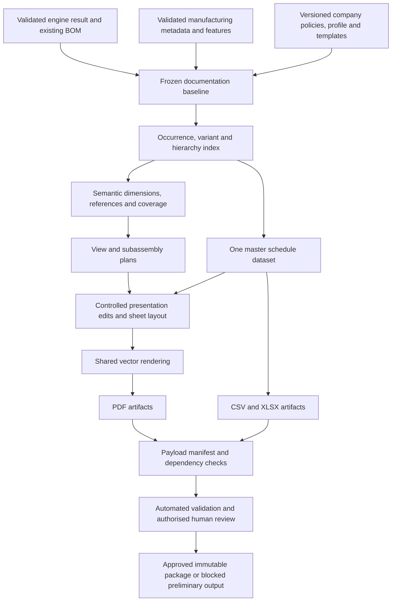

# Drawing architecture audit and roadmap — Phase 5A

**Phase 5B.2 implementation update:** [Assembly hierarchy, exploded views and reusable subassembly sheets](assembly-drawings.md) now implement the preliminary rectangular-panel assembly slice. They preserve the engineering source and false readiness/compliance; the complete manufacturing/release architecture below remains staged.

**Status:** architecture/interface proposals only, dated 16 November 2026. The agreed behaviour and acceptance criteria are in [the manufacturing documentation specification](drawing-manufacturing-specification.md). Nothing below is an implemented release capability or standards claim. Proposed module names and code blocks are design contracts, not new source files or a commitment to final API spelling.

## 1. Repository audit: existing, extendable and new

The repository was clean before this task. This audit inspected `src/furniture/`, `src/drawings/`, `src/components/drawings/`, the furniture/drawing documentation, package dependencies and existing test sources/runner. Only the two Phase 5A Markdown deliverables are added. Source, geometry, profiles and test implementations remain unchanged; no TypeScript/lint/test/build commands are run for this documentation-only change.

| Area / requirements | What exists and evidence | Extend in place | New capability required |
| --- | --- | --- | --- |
| Engineering authority | [types](../src/furniture/types.ts), [engine](../src/furniture/engine.ts), validation/contact checks and [BOM](../src/furniture/bom.ts). Global minimum-corner panel coordinates, explicit assemblies, nominal cut blanks. | Read-only adapters and new validated engineering extensions when their source data is approved. | Manufacturing feature/metadata authority; do not put feature sizing in the drawing renderer. |
| Revision identity / R13, R15 | [revision.ts](../src/furniture/revision.ts) canonically snapshots non-verification specification parameters plus engine algorithm revision. Assumption records bind to that string. | Preserve that revision verbatim as an input dependency. | Full documentation baseline over metadata, policies, template/profile, layout edits, exporters and evidence; trusted approval/revocation. The current revision is not a signature. |
| View generation / R01, R02 | [generate.ts](../src/drawings/generate.ts) uses four fixed GA cells; [projections.ts](../src/drawings/projections.ts) supplies front/top/right, clipped panel outlines and parallel wireframe isometric. Four overall/carcass dimensions are constructed inside the generator. | Existing projections, scale fitting, source references and facade. | Family-aware view intent/ranking, dominant primary layout, functional dimension requirements and later section/detail/rear-view capabilities. Large chest isometric is a target, not current behaviour. |
| Dimensions / R06–R08 | `DrawingDimension` holds 2D endpoints, numeric value, direction, paper offset and references. [dimensionPlot.ts](../src/drawings/dimensionPlot.ts) renders it. | Retain as a resolved presentation primitive. | 3D semantic measurements, dimension/inspection coverage graph, stable geometry references, part frames, datum/tolerance policy resolution and controlled edit records. |
| Items/annotations / R03, R05 | [annotations.ts](../src/drawings/annotations.ts) numbers panel BOM membership deterministically; [annotationGeometry.ts](../src/drawings/annotationGeometry.ts) checks sampled edge visibility; semantic/placed balloon entities are already separate. | Item/annotation adapters, diagnostics, visibility, shared rendering. | Durable part/variant registry and hierarchical scoped items. Current item labels 1–7 are neither persistent company numbers nor a hierarchical BOM. |
| Subassemblies / R04 | Engine `Assembly.parentId` and direct `componentIds` identify carcass and drawers. | Traverse these relationships; preserve global coordinates. | Complexity decisions, equivalent-subassembly comparison, per-scope quantities, subassembly coverage and drawings. AP sheets are overflow parts lists, not subassembly drawings. |
| Coverage/reconciliation / R03, R05, R11 | [reconcile.ts](../src/drawings/reconcile.ts) checks all components/BOM/schedule links and panel dimensions; annotation validation checks item/list/anchor relationships even if output is hidden. | Keep these validators and add scope/variant checks. | Requirement-to-feature/dimension/artifact coverage, missing metadata classification and manufacturing-variant conservation. Current checks do not prove manufacturing completeness. |
| Metadata/features / R08–R11 | Material IDs, stock thicknesses, closed geometry, runner envelopes and schematic bracket/fixing anchors. | Use existing IDs and nominal dimensions. | Approved materials/codes, grain, edge/face identities, finishes, finished sizes, validated machining features, tolerance evidence and inspection plans. Anchors/envelopes are not drilling definitions. |
| Layout/company settings / R01, R05, R14 | [layout.ts](../src/drawings/layout.ts), [assemblyPartsList.ts](../src/drawings/assemblyPartsList.ts), profile v2, local v1/v2 preference loading, title blocks, reserved extension IDs and AP pagination. | Preserve settings/UI, migrations, fixed paper units and readable table continuation. | Complexity-aware component layouts, company zones/assets/font handling and typed field bindings. Future isolated DWG/DXF template ingestion; current extension IDs are inert. |
| Export / R12, R15 | [plot.ts](../src/drawings/plot.ts), [annotationPlot.ts](../src/drawings/annotationPlot.ts), SVG preview and [pdf.ts](../src/drawings/pdf.ts) share vector primitives. UI downloads the whole visible PDF package. | Reuse vector primitives/PDF writer and current drawing facade. | Standalone schedule PDF, CSV/XLSX, selected artifact APIs, immutable export job, manifests, dependency-complete ZIP and file-integrity verification. No XLSX/ZIP export integration or direct writer dependency exists. |
| Release / R13 | Both manufacturing readiness and drawing compliance are literal false. Hardware allowances have zero approved purchasing quantity and an empty approved list. | Preserve all restrictions and existing warnings. | Authorised identity, evidence review, signed/verified approvals, policy enforcement and audit/revocation storage. Local preference storage is not a release authority. |

### Existing verification evidence and gaps

The Phase 4C.2 documentation records **274 passing tests**, TypeScript/lint checks, a Webpack production build and Chrome/PDF checks. These are historical results, not a new Phase 5A run. The source tests and [runner](../tests/run-tests.mjs) confirm the intended coverage:

- [furniture.test.ts](../tests/furniture.test.ts): reference geometry, BOM/contact validity, parameters/counts, missing parts, hardware and stale assumption evidence.
- [drawings.test.ts](../tests/drawings.test.ts) and [drawingPackage.test.ts](../tests/drawingPackage.test.ts): current nominal dimensions, both projection conventions, panel coverage, schedules, page bounds and vector PDF content.
- [drawingProfiles.test.ts](../tests/drawingProfiles.test.ts): settings combinations, preferences, hidden output, numbering, company fields and purchasing exclusion.
- [drawingAnnotations.test.ts](../tests/drawingAnnotations.test.ts): membership-based numbering, 29 occurrences, visibility, parts-list reconciliation, both profiles/conventions/formats, migration and PDF circles.
- Viewer/movement/explosion tests preserve closed-model geometry/BOM independently of display transforms.

They do not establish complete functional/inspection dimension coverage, hierarchical purchasing BOMs, machining correctness, approved tolerances, finished-size semantics, cross-format schedule equality, authorised release or ZIP integrity. The prior default Turbopack build hit a local worker-port restriction; Webpack builds passed. Browser checks used hydrated local artifacts with request interception. Future implementation should retain that fallback without claiming it replaces testing a deployed release/approval service.

## 2. Target architecture and boundaries

Keep `generateDrawingDocument` as a compatibility facade. Extract orchestration incrementally into pure planners/resolvers rather than replacing the generator. Keep existing `DrawingViewport`, `DrawingDimension` and `PlotEntity` as downstream presentation objects, with adapters from richer semantic plans. Changes to runtime schemas need explicit versioning/migration; current parsers correctly reject unknown future fields.



### Responsibility split

1. **Engineering authority:** owns all nominal geometry and actual feature values. Drawing code cannot add a groove, deduct edging thickness or choose a screw position. Future feature definitions must first be validated against the appropriate engineering model/extension.
2. **Metadata/policy authority:** owns material selections, grain, treatments, finishes, tolerance/process policies and applicability/evidence. Missing values are explicit. Presentation profiles never confer approval.
3. **Document planning:** derives source-linked views, scopes, semantic dimensions, numbering and coverage requirements. Nominal measurement evaluation uses engine geometry/facts; it is independent of paper scale.
4. **Presentation:** selects slots/scales, resolves leaders and places dimension text. Overrides retain their target IDs and reasons. Invalid/obsolete references become diagnostics, not numeric fallback values.
5. **Schedule projection:** builds the ten-field master dataset once. Embedded/standalone formats consume it; exporters do not regroup parts independently.
6. **Export and release:** renders one immutable baseline, computes artifact hashes and checks selected-scope closure. A separate trusted authority verifies human approvals and handoff eligibility. The existing engine's literal false readiness is not bypassed by this layer.

### Identity, grouping and revisions

- Preserve original component/assembly IDs; add a separate instance namespace if multiple engine results are combined. Follow `Assembly.parentId`/membership rather than splitting ID strings.
- Keep engine stock-blank groups intact. A derived manufacturing variant partitions source occurrences using validated machining, grain, edging, finish and handedness metadata. Variant partitions must be disjoint/exhaustive and conserve engine quantities. Unknown data cannot establish interchangeability.
- Introduce a versioned part-number/variant registry only after company policy review. Keep durable part numbers, assembly-scoped balloon labels and physical IDs distinct. Map existing `bom-membership-v1` labels during transition rather than claiming they are immutable business numbers.
- A scoped list can reuse the same part number with a different quantity. Build each subassembly list from descendants; reconcile root leaf totals once. Do not add assembly summary quantities to their leaf-part totals.
- Freeze the engineering result and all input versions before planning/export. Include semantic/presentation dependencies in the baseline. Existing engineering revision text and human revision labels remain available, but neither is the sole documentation identity nor an authority proof.

### Proposed modules — not created in Phase 5A

| Proposed module / owner | Responsibility | Integration seam |
| --- | --- | --- |
| `src/drawings/planning/context.ts` | Immutable baseline, source adapter, rule versions and stale-input detection. | Wrap the current result/profile arguments. |
| `src/drawings/planning/references.ts` | Stable face/edge/frame/fact resolution with explicit unresolved states. | Use existing global panel geometry; later consume validated feature geometry. |
| `src/drawings/planning/dimensions.ts` | Semantic dimension evaluation, deduplication and requirement coverage. | Adapt resolved measures into existing `DrawingDimension`. |
| `src/drawings/planning/views.ts` | Family primary-view policy, candidate scoring, supporting/detail view intent. | Existing `projectPoint`/projection adapters; register capabilities explicitly. |
| `src/drawings/planning/subassemblies.ts` | Complexity/equivalence decisions and scope-based documentation. | Existing assembly relationships, source quantities and item/variant index. |
| `src/manufacturing/metadata.ts`, `features.ts`, `policies.ts` | Engineering-owned validated manufacturing definitions, known/unknown/approved states and evidence. | Read-only versioned input to drawings; no new geometry calculations in the UI. |
| `src/manufacturing/parts.ts`, `schedules.ts` | Part registry/variants and canonical ten-field dataset with source reconciliation. | Extend existing schedule generation; preserve original BOM. |
| `src/drawings/planning/presentation.ts`, `templates.ts` | Targeted presentation edit records, company zones/assets and readable layout. | Extend current layout/annotation/paper primitive pipeline. |
| `src/drawings/exports/` | Selected PDF, standalone schedules, CSV/XLSX, manifest/ZIP jobs. | Existing PDF/vector path plus format adapters; dependencies chosen only when implemented. |
| `src/manufacturing/release/` | Validation policy, authorised approval adapter, audit/revocation and package handoff. | New trusted boundary, not local profile state. |
| Future template ingestion boundary | Isolated, bounded DWG/DXF interpretation into a safe internal layout schema. | Accept versioned vetted templates; never execute uploaded content in the renderer. |

## 3. Proposed TypeScript contracts

These code blocks form a documentation proposal, not executable additions. Names are deliberately distinct from existing drawing types. Imports below refer to current types for context; validators, persistence, hash generation and trusted approval implementations are not provided. Type declarations alone cannot guarantee validity, authorisation or manufacturing completeness.

### 3.1 Shared provenance and documentation baseline

```ts
import type { FurnitureResult, FurnitureSpecification, Vector3 } from "../src/furniture";
import type { DrawingProfile, Point2, Rect } from "../src/drawings";

type EntityId = string;
type Sha256 = string; // Runtime-validated digest; not an authentication signature.
type DeepReadonly<T> = T extends object
  ? { readonly [K in keyof T]: DeepReadonly<T[K]> } : T;

interface EvidenceRef { id: EntityId; contentDigest: Sha256 }
interface ApprovalRef { id: EntityId; approvedSubjectDigest: Sha256 }
type ReviewedValue<T> =
  | { state: "unspecified"; reason: string }
  | { state: "provided"; value: T; evidence: EvidenceRef[] }
  | { state: "approved"; value: T; approval: ApprovalRef }
  | { state: "not-applicable"; reason: string; approval: ApprovalRef };

interface OccurrenceRef {
  instanceId: EntityId; componentId: string; assemblyId: string;
}
interface AssemblyRef { instanceId: EntityId; assemblyId: string }
type InputBinding =
  | { state: "pinned"; id: EntityId; version: string; digest: Sha256 }
  | { state: "not-supplied"; reason: string };

interface DocumentationBaseline {
  schemaVersion: 1;
  projectId: EntityId;
  engineeringRevisions: Readonly<Record<EntityId, string>>; // Instance → existing revision.
  geometryAndBomDigest: Sha256;
  engineeringEvidence: InputBinding; // Evidence is excluded from the current engine revision.
  manufacturingMetadata: InputBinding;
  partRegistry: InputBinding;
  coverageRules: InputBinding;
  datumAndTolerancePolicy: InputBinding;
  profile: InputBinding;
  companyTemplate: InputBinding;
  presentationEdits: InputBinding;
  releasePolicy: InputBinding;
  toolVersions: Readonly<Record<string, string>>;
  toolchain: InputBinding; // Resolve/pin actual planner/renderer/exporter build content.
  baselineDigest: Sha256; // Hash canonical inputs, excluding this field itself.
}

interface DocumentationContext {
  baseline: DocumentationBaseline;
  engineeringSources: ReadonlyArray<{ instanceId: EntityId;
    result: DeepReadonly<FurnitureResult>;
    specification?: DeepReadonly<FurnitureSpecification> }>;
  profileSnapshot: DeepReadonly<DrawingProfile>;
  purpose: "preliminary-review" | "manufacturing-release-request";
}
```

The current one-result facade adapts to one source instance; combined projects keep a distinct original-ID namespace per instance. Where supplied, the original specification must match the result revision; absent evidence/specification input cannot be treated as verified. `not-supplied` bindings make a preliminary slice honest about unavailable inputs; they are not substitute approval values. Existing verification text is excluded from `getFurnitureRevision`, so its evidence/approval inputs need their own pinned binding. Evidence/field approvals must resolve to the pinned subject version. Changing any input changes the baseline and invalidates affected outputs. Initial policy conservatively requires reapproval for all changed approved content; narrower change classifications require a later approved policy. Resolve and verify approvals outside the type system.

### 3.2 Geometry references, semantic dimensions and datums

```ts
type GeometryRef =
  | { kind: "panel-face"; occurrence: OccurrenceRef;
      axis: "x" | "y" | "z"; side: "min" | "max" }
  | { kind: "panel-edge"; occurrence: OccurrenceRef;
      edgeKey: EntityId; topologyVersion: string }
  | { kind: "panel-vertex"; occurrence: OccurrenceRef;
      corner: { x: "min" | "max"; y: "min" | "max"; z: "min" | "max" } }
  | { kind: "assembly-envelope"; assembly: AssemblyRef;
      axis: "x" | "y" | "z"; side: "min" | "max";
      envelopePolicyId: EntityId }
  | { kind: "feature-geometry"; featureId: EntityId;
      geometryKey: EntityId; geometryDigest: Sha256 };

interface PartReferenceFrame {
  id: EntityId; occurrence: OccurrenceRef;
  origin: Extract<GeometryRef, { kind: "panel-vertex" | "feature-geometry" }>;
  u: Vector3; v: Vector3; normal: Vector3; resolverVersion: string;
}
interface DatumSystemProposal {
  id: EntityId; frameId: EntityId;
  orderedReferences: GeometryRef[];
  selection: "policy-proposal" | "engineering-override";
  reason: string; approval: ReviewedValue<EvidenceRef[]>;
}
type ToleranceBinding =
  | { kind: "unspecified"; reason: string }
  | { kind: "dimension-specific"; definitionId: EntityId }
  | { kind: "company-general"; policyId: EntityId; ruleId: EntityId }
  | { kind: "not-applicable"; approval: ApprovalRef };

interface ToleranceDefinition {
  id: EntityId; revision: string;
  limits: ReviewedValue<{ unit: "mm" | "deg";
    lowerDeviation: number; upperDeviation: number }>;
  applicability: { processIds: EntityId[]; materialIds: string[];
    featureKinds: string[] };
  critical: boolean;
}
interface DimensionRequirement {
  id: EntityId; scopeIds: EntityId[]; sourceFeatureIds: EntityId[];
  characteristicKey: string; ruleId: EntityId; ruleVersion: string;
  purpose: "overall" | "functional" | "manufacturing" | "inspection";
  requiredForRelease: boolean; critical: boolean;
}
type SemanticMeasurement =
  | { kind: "linear"; from: GeometryRef; to: GeometryRef;
      direction: Vector3; unit: "mm" }
  | { kind: "diameter" | "radius"; featureId: EntityId; unit: "mm" }
  | { kind: "angle"; first: GeometryRef; second: GeometryRef; unit: "deg" };

interface SemanticDimension {
  schemaVersion: 1; id: EntityId; baselineDigest: Sha256;
  requirementIds: EntityId[]; measurement: SemanticMeasurement;
  referenceFrameId: EntityId; datumSystemId?: EntityId;
  tolerance: ToleranceBinding;
  evaluation:
    | { status: "resolved"; value: number; unit: "mm" | "deg";
        resolverVersion: string; sourceDigest: Sha256 }
    | { status: "unresolved"; reason: string };
}
interface DimensionPresentation {
  dimensionId: EntityId; viewId: EntityId;
  role: "controlling-display" | "reference-repeat";
  textPosition?: Point2; paperOffsetMm?: number;
}
```

`edgeKey`/frame resolution must stay stable when long/short face lengths swap; current sorted cut dimensions remain unchanged. The reference frame does not establish an approved inspection datum merely by existing. Measurement values are resolver-owned caches, never editable label strings. Linear measurement is evaluated in the declared model direction, not from an isometric image. A repeated display points to the same semantic dimension; coverage validation prevents competing controlling dimensions or an omitted last required display. An engineering datum/tolerance override is a new validated dependency, not a presentation edit.

### 3.3 Views, hierarchy and controlled presentation

```ts
interface DrawingViewPlan {
  schemaVersion: 1; id: EntityId; scopeId: EntityId;
  role: "primary-ga" | "supporting" | "subassembly" | "component" | "detail";
  projection: { kind: "parallel";
    orientation: "front" | "top" | "right" | "isometric" | "registered-extension";
    basis: { right: Vector3; up: Vector3; towardCamera: Vector3 } };
  sourceOccurrences: OccurrenceRef[]; sourceFeatureIds: EntityId[];
  dimensionIds: EntityId[]; annotationIds: EntityId[];
  parentViewId?: EntityId;
  derivation?:
    | { kind: "detail"; regionGeometry: GeometryRef }
    | { kind: "section"; cuttingPlane: { origin: GeometryRef; normal: Vector3 } };
  selection: { policyId: EntityId; policyVersion: string;
    reasons: string[]; overriddenByEditId?: EntityId };
  requiredForRelease: boolean;
}
interface HierarchicalItem {
  id: EntityId; scopeAssembly: AssemblyRef;
  parentItemId?: EntityId;
  childItemIds: EntityId[]; scopedLabel: string;
  occurrences: OccurrenceRef[]; sourceBomIds: string[];
  quantityPerScope: number;
  subject:
    | { kind: "panel"; partVariantId: EntityId }
    | { kind: "subassembly"; assemblyOccurrences: AssemblyRef[];
        equivalenceGroupId: EntityId }
    | { kind: "hardware-allowance"; approvedPurchasingQuantity: 0 }
    | { kind: "approved-hardware"; selectionId: EntityId; approval: ApprovalRef };
}
interface SubassemblyDrawingPlan {
  id: EntityId; assembly: AssemblyRef;
  memberOccurrences: OccurrenceRef[];
  equivalentAssemblyOccurrences: AssemblyRef[];
  scopedItemIds: EntityId[]; viewIds: EntityId[];
  requirementIds: EntityId[];
  decision: { status: "required" | "not-required" | "unresolved";
    policyId: EntityId; policyVersion: string; reasons: string[];
    overrideApproval?: ApprovalRef };
}
interface PresentationEdit {
  id: EntityId; baseBaselineDigest: Sha256; targetId: EntityId;
  reason: string; authorId: EntityId;
  change:
    | { kind: "move-label"; at: Point2 }
    | { kind: "leader-route"; paperPoints: Point2[] }
    | { kind: "choose-view"; registeredViewPolicyOption: string }
    | { kind: "choose-scale"; scale: number }
    | { kind: "suppress-display"; replacementPresentationId: EntityId };
}
```

The scope index comes from real engine assemblies and descendants. Assembly summary rows count `assemblyOccurrences`; leaf rows count their source component occurrences, and those two quantity kinds are never summed together. Repeated-drawer equivalence compares normalised relative geometry and manufacturing metadata while preserving all original global coordinates/IDs; it does not apply assembly translation twice. Registered view extensions must reject unsupported geometry rather than approximate missing sections. A frame origin/section origin must resolve to an unambiguous point; vector bases/directions must pass the appropriate unit/orthogonality checks. Complexity rules give reasons and review status before deciding whether an existing drawer needs a separate manufacturing drawing. Overrides that would remove coverage, break projection placement or detach a leader are rejected.

### 3.4 Reusable semantic annotations and validated manufacturing features

```ts
type PlannedAnnotation =
  | { kind: "balloon"; id: EntityId; scopedItemId: EntityId;
      candidateOccurrences: OccurrenceRef[]; preferredAnchor?: GeometryRef }
  | { kind: "parts-list"; id: EntityId; assembly: AssemblyRef;
      itemIds: EntityId[] }
  | { kind: "note"; id: EntityId; content: ReviewedValue<string>;
      relatedRequirementIds: EntityId[] }
  | { kind: "section-reference" | "detail-reference"; id: EntityId;
      parentViewId: EntityId; childViewId: EntityId; source: GeometryRef }
  | { kind: "feature-callout"; id: EntityId; featureId: EntityId;
      dimensionIds: EntityId[] };

interface ResolvedAnnotationAnchor {
  annotationId: EntityId; viewId: EntityId; source: GeometryRef;
  modelPoint: Vector3;
  visibility: "visible" | "occluded" | "unresolved";
  resolverVersion: string; sourceDigest: Sha256;
}
interface AnnotationPresentation {
  annotationId: EntityId; viewId: EntityId;
  frame?: Rect; labelAt?: Point2; leaderPaperPoints?: Point2[];
  styleId: EntityId; editIds: EntityId[];
}

interface ValidatedFeatureSource {
  authority: "validated-engineering-extension";
  featureId: EntityId; engineeringRevision: string;
  geometryDigest: Sha256; evidence: EvidenceRef[];
}
type ManufacturingFeature = {
  id: EntityId; partVariantId: EntityId; frameId: EntityId;
  source: ValidatedFeatureSource; requirementIds: EntityId[];
} & (
  | { kind: "hole"; centreInPartFrame: Vector3; direction: Vector3;
      diameterMm: number;
      extent: { kind: "through" } | { kind: "blind"; depthMm: number } }
  | { kind: "groove" | "rebate" | "pocket";
      profileGeometry: GeometryRef; depthMm: number;
      accessFace: GeometryRef }
  | { kind: "edge-treatment"; edge: GeometryRef;
      treatmentDefinitionId: EntityId }
);
interface PartManufacturingDefinition {
  id: EntityId; revision: string; occurrences: OccurrenceRef[];
  frame: PartReferenceFrame;
  features: ReviewedValue<ManufacturingFeature[]>;
  grain: ReviewedValue<{ direction: Vector3; visibleFace: GeometryRef }>;
  edgeTreatments: ReviewedValue<{ edge: GeometryRef; definitionId: EntityId }[]>;
  surfaceFinishes: ReviewedValue<{ face: GeometryRef; finishCode: string }[]>;
}
```

These shapes reserve future feature support; they do not instantiate any hole/operation on today's chest. Current feature information is **unassessed/unspecified**, not an approved empty feature list. Feature parameters must originate in a validated engineering extension, including accessibility/stock/interface checks appropriate to the operation. A user text note or existing hardware anchor cannot create a `ValidatedFeatureSource`. Future geometry/feature changes invalidate the source revision and need engineering validation before drawing regeneration.

### 3.5 Master schedule projection and manufacturing variants

```ts
interface PartVariant {
  id: EntityId; registryRevision: string;
  partNumber: ReviewedValue<string>;
  sourceBomIds: string[]; occurrences: OccurrenceRef[];
  manufacturingDefinitionId: EntityId;
  equivalencePolicyId: EntityId;
}
interface NominalSize { lengthMm: number; widthMm: number; thicknessMm: number }
interface MasterManufacturingRow {
  rowId: EntityId; baselineDigest: Sha256; partVariantId: EntityId;
  partNumber: ReviewedValue<string>;                       // 1
  description: string;                                    // 2
  quantity: number;                                       // 3: source scope/unit below
  nominalCutDimensions: ReviewedValue<NominalSize>;         // 4
  material: { sourceId: string; companyCode: ReviewedValue<string> }; // 5
  grain: PartManufacturingDefinition["grain"];              // 6
  edgeTreatments: PartManufacturingDefinition["edgeTreatments"]; // 7
  finishedDimensions: ReviewedValue<NominalSize>;           // 8
  surfaceFinishes: PartManufacturingDefinition["surfaceFinishes"]; // 9
  manufacturingNotes: ReviewedValue<string[]>;              // 10
  trace: { sourceBomIds: string[]; occurrences: OccurrenceRef[];
    scopeId: EntityId; unit: "piece";
    classification: "panel" | "hardware-allowance" | "approved-hardware";
    approvedPurchasingQuantity: number };
}
```

The projection populates nominal cuts from existing BOM values and marks their nominal status; it does not recalculate or silently authorise cutting allowances. Finished dimensions remain unspecified until an approved engineering relationship exists. Technical row IDs/source links/status/unit are retained separately from the ten business field groups. A standalone single CSV must carry its own technical provenance columns; a mandatory companion is acceptable only when delivered with it in a defined bundle. XLSX can use a traceability sheet. Approved purchasing quantities are zero for every current hardware allowance, regardless of the displayed source quantity. A future approved selection must reconcile to verified engineering data; it cannot be a profile toggle.

### 3.6 Company layout contract

```ts
interface TemplateAssetRef {
  id: EntityId; digest: Sha256;
  kind: "logo" | "font" | "border" | "import-source";
}
interface CompanyDrawingTemplate {
  schemaVersion: 1; id: EntityId; version: string; companyId: EntityId;
  assets: TemplateAssetRef[];
  format: "A4" | "A3" | "A2" | "A1"; units: "mm";
  zones: { id: EntityId; role: "primary" | "supporting" | "table" | "title-block";
    frame: Rect }[];
  fieldBindings: { slotId: EntityId; semanticFieldKey: string }[];
  readabilityPolicyId: EntityId;
  importedSource?: { format: "dwg" | "dxf";
    asset: TemplateAssetRef; parserVersion: string;
    validatedMappingDigest: Sha256 };
  standardsClaim: ReviewedValue<{ edition: string; assessedScope: string[] }>;
}
```

Only vetted semantic field keys may be bound; templates cannot replace engineering values with arbitrary constants. Asset resolution, font coverage/licensing, sanitisation and supported entity mappings require explicit validators. `importedSource` describes a future accepted result of an isolated ingestion process, not permission to parse DWG/DXF in Phase 5B. Company tolerance approvals belong to a separate engineering policy binding, even if the template displays their approved note.

### 3.7 Export selection, manifests and authorised approval boundary

```ts
interface ExportSelection {
  purpose: "preliminary-review" | "manufacturing-release-request";
  scopeIds: EntityId[]; requestedArtifactIds: EntityId[];
  formats: ("pdf" | "csv" | "xlsx")[];
  includeDependencies: boolean;
}
interface ExportArtifact {
  id: EntityId; relativePath: string; format: "pdf" | "csv" | "xlsx" | "json";
  role: "drawing" | "schedule" | "traceability" | "validation-report";
  baselineDigest: Sha256; scopeIds: EntityId[];
  semanticContentDigest: Sha256;
  byteLength: number; fileDigest: Sha256;
  dependencyArtifactIds: EntityId[];
}
interface ReleaseManifestCore {
  schemaVersion: 1; exportRunId: EntityId;
  baseline: DocumentationBaseline; selection: ExportSelection;
  artifacts: ExportArtifact[]; // Payload only: excludes manifest.json itself.
  omittedArtifacts: { id: EntityId; reason: string }[];
  dependencyClosure: "complete" | "incomplete";
  validation: { reportDigest: Sha256; policyDigest: Sha256;
    status: "passed-for-scope" | "blocked" };
  releaseCapability: "preliminary-only" | "reviewed-future-capability";
}
interface AuthorisedApproval {
  id: EntityId; decision: "approve" | "reject";
  manifestCoreDigest: Sha256;
  signerId: EntityId; authorisedRoleId: EntityId; issuerId: EntityId;
  evidence: EvidenceRef[]; signedAt: string;
  signature: string; // Verified by a trusted authority, not by UI assertion.
}
interface ManufacturingExportManifest {
  core: ReleaseManifestCore; coreDigest: Sha256;
  approvals: AuthorisedApproval[];
  status: "preliminary" | "awaiting-authorised-review" | "approved" | "revoked";
}
interface ReleaseAuthority {
  verify(approval: AuthorisedApproval, coreDigest: Sha256): Promise<{
    authorised: boolean; current: boolean; reasons: string[];
  }>;
}
```

Sign/hash a canonical manifest **core** covering all payload hashes and baseline/scope. Keep approval envelopes and `manifest.json` outside their own payload list to avoid circular self-hashes. An outer ZIP checksum can be supplied in a separate download receipt. A claimed `status: "approved"` is not trusted until the authority, signature/current role, revocation, validation report, source capability and coverage all pass; runtime enforcement must be authoritative. No current caller can manufacture approval by constructing these TypeScript objects. The existing engine's `manufacturingReady: false` is a release blocker until a separately reviewed capability/schema change exists.

### Export protocol and structured package

Proposed artifact layout (only required/selected artifacts are included):

```text
manifest.json
validation/report.json
drawings/ga/<drawing-id>.pdf
drawings/subassemblies/<scope-id>/<drawing-id>.pdf
drawings/components/<variant-id>/<drawing-id>.pdf
drawings/details/<drawing-id>.pdf
schedules/master-bom.pdf
schedules/master-bom.csv
schedules/master-bom.xlsx
schedules/cutting-list.<format>
schedules/edge-treatments.<format>
schedules/finishes.<format>
traceability/occurrences.json
```

1. Freeze context/selection, determine required dependency closure and disclose missing information. A preliminary selection may omit artifacts; a release request cannot hide requirements for its selected scope.
2. Resolve the master rows and semantic drawing/coverage plan once. Layout and preview use the same resolved plan as exporters.
3. Generate payloads into one export job, with pinned versions and consistent units/precision/status. Each artifact carries baseline/scope information; CSV/XLSX carry technical IDs/statuses directly or through the defined mandatory companion schema. Preserve typed numbers and leading-zero identifiers; safely encode formula-like text.
4. Verify semantic row/quantity/dimension equality across formats, page numbering, paths and artifact dependencies; compute final byte hashes. Byte reproducibility requires controlled timestamps/fonts/renderer inputs; semantic consistency is required even where a writer is not byte-deterministic. Never reuse cached bytes by filename alone.
5. Assemble the manifest core. Only a future reviewed release workflow can request authorised signatures over that exact core. Final packaging includes the verified approval envelope. A later content change needs a new core/approval.
6. Publish the completed download atomically; cancellation, resource limits or any failed artifact cannot leave an apparently complete manufacturing ZIP. Guard path traversal, duplicate names, unsupported formats and unbounded file/page generation.

An individual artifact from an approved frozen package may retain its original hash and link to the full approved manifest, but must identify itself as a partial selection. A new subset ZIP cannot inherit whole-assembly completeness: establish its own complete approved scope/closure, or keep it preliminary. If the live model changes during an export, either cancel/restart or finish the captured snapshot with its revision explicitly identified; never mix old geometry with new filenames/profile fields. Production handoff should require explicit selection of the approved current/superseded policy state.

## 4. Architecture risks and required mitigations

| Risk | Current exposure / failure example | Required mitigation and acceptance evidence |
| --- | --- | --- |
| Stale revisions | Geometry revision omits profile/template/metadata/presentation inputs; drawing revision text can be reused. | Canonical baseline with all dependencies, immutable export jobs, stale binding diagnostics and reapproval. Concurrent parameter/profile/metadata edit tests. |
| Lost occurrence identity | Regrouping, label changes or ID-path parsing can detach rows/anchors from source components. | Explicit instance/occurrence/assembly references and registries; conservation tests, shared-role/multiple-instance fixtures, invalid-reference rejection. |
| False finished-part equivalence | Equal cut blanks can require different drilling, grain, edging or finishes. | Validated variant partition over engine groups; unknown metadata does not justify interchangeability. Reconcile all original quantities. |
| Duplicate/conflicting dimensions | Each view computes its own values or repeats independent controlling dimensions. | One semantic characteristic/measurement graph, resolver-owned values and explicit reference displays; closure/contradiction tests. |
| Unreliable view/anchor selection | Camera/explosion state or wireframe visibility is treated as manufacturing visibility. | Deterministic family policy and registered geometric capabilities; visibility evidence, alternate/detail views and unresolved coverage. Preserve the current 21 concealed-occurrence case. |
| Unstable reference edges | Sorting face lengths rotates a part frame when width/height cross. | Stable topology/local axes, explicit grain/datum mappings, re-resolve overrides and mirrored/size-swap fixtures. |
| Invented manufacturing facts | Unspecified finish is rendered as “none”, a generic bracket anchor becomes a drill location, or nominal gap is labelled a tolerance. | Typed unknown/provided/approved/not-applicable states, source/evidence authority and release blockers; negative tests for all missing fields. |
| Double-counted hierarchy | Root quantities are repeated as per-drawer quantities or assemblies are summed with their parts. | Scoped descendant index and separate assembly summaries; single leaf conservation against source BOM. |
| Layout hides required information | Fonts shrink, a template overwrites mandatory zones, hidden schedules still allow release. | Approved readability policy, coverage-aware layout, extra sheets and strict release-scope validation. Profiles remain presentation choices. |
| Inconsistent exports | CSV/XLSX regroup or round independently; selected PDFs have wrong totals or mixed revisions. | One frozen master dataset/plan; format adapters with typed schemas, semantic equality, dependency closure and manifest hashes. |
| False approval/security | LocalStorage/name/status/checksum is accepted as an authorised engineering release. | Trusted identity/signature/evidence/revocation boundary and server/external-authority enforcement; reject self-declared approval. |
| Circular/incomplete package integrity | Manifest includes its own hash or approval signs content that changes afterwards. | Canonical unsigned core, payload-only hash list, detached approval envelope and atomic completion tests. |
| Template/parser/font hazards | Untrusted DWG/DXF entities/links/scripts or unsupported glyphs alter output. | Isolated bounded ingestion, explicit capabilities, asset hashes, font validation and no silent character replacement for production-required text. |
| Legacy profile drift | New settings silently enable machining/annotation assumptions or overwrite saved preferences. | Explicit version adapters, old-profile fixtures, no automatic storage rewrite and preserved preliminary status. |

## 5. Recommended Phase 5B slice

**Phase 5B.1 update:** [continuous solid-panel edge clipping](isometric-visibility.md) now provides clean isometric output for current engineering box panels. Arbitrary-solid hidden-line solving and sections remain future work; the Phase 5B.2 update above supplies rectangular-panel exploded/subassembly plans.

**Implementation update (17 November 2026):** [Phase 5B](general-assembly-planning.md) implements this preliminary slice in `src/drawings/planning/` while retaining the existing generator. The audit/proposed interfaces above describe the Phase 5A baseline and future architecture, not all current executable contracts. Current output uses a dominant chest isometric, four source-bound semantic dimensions, profile-aware coverage diagnostics and validated shared SVG/PDF output. Unsupported families are rejected for a registered policy; hidden supporting dimensions remain reported unmet. No GA continuation capability was needed for the tested formats; parts-list AP continuation remains supported. The proposed full manufacturing baseline, datums/tolerances, variant registry, approval and package-manifest infrastructure remain deferred.

**Implement one revision-bound chest GA planning slice: a dominant isometric view intent plus semantic records for the four existing nominal GA dimensions.** This connects the new architecture to visible behaviour without inventing manufacturing data or undertaking the entire roadmap.

### Included

1. Capture a read-only preliminary planning context over the existing engine result, profile and versioned planner/resolver inputs. Preserve `specificationRevision`; record absent future metadata/approval dependencies as unavailable, not dummy approved values.
2. Add a chest family policy selecting parallel isometric as the primary view, with explainable fallback for unsupported families. Give primary isometric the largest view region; supporting orthographic projections retain convention/alignment. Reuse readable table/AP fallback and existing balloon visibility rules; add a GA continuation if constraints cannot fit.
3. Represent **only the existing overall width, overall height, overall closed panel depth and carcass depth** as semantic measurements with stable IDs/source references, then adapt them to current `DrawingDimension` plotting. Keep true-length dimensions in appropriate orthographic views. Values remain 900/850/518/500 mm for the unchanged reference.
4. Add minimal coverage checks: each of those four requirements is resolved, has one controlling display and permitted explicit reference repeats, and none is duplicated/detached after regeneration. A removed required supporting view is replaced/readably continued or reported as unmet preliminary coverage.
5. Retain the six-sheet reference package where feasible; additional pages are acceptable when needed for clarity and must be reflected in numbering/export. Preserve flat seven-item/29-panel traceability, profile compatibility and literal false readiness/compliance.

### Explicitly deferred

No new functional design dimensions, manufacturing completeness claim, datum/tolerance values, subassembly manufacturing decisions, machining geometry, materials/finish assumptions, part-number registry, new schedule formats, company-template import, release authority or ZIP implementation. Presentation-only movement controls can remain deferred; this slice establishes target IDs first. Future profile changes need an explicit migration only if new persisted controls are introduced.

### Exit criteria

- Reference geometry/BOM are byte-for-byte unchanged as serialised domain data; 29 panel IDs/seven groups and the 160/8/8 excluded allowances remain intact.
- Chest primary intent is isometric; its view region is larger than each secondary region, all mandatory content is readable and neither template/convention breaks.
- Four semantic values match the existing dimensions before/after width/height/depth edits and reordered source arrays. Paper scale, circle placement and viewer opening/explosion cannot change values/IDs.
- Unsupported/unresolved source facts and hidden required dimension coverage produce explicit diagnostics; no numeric fallback or empty substitute view.
- Shared SVG/PDF output matches the planned views/dimensions and all generated pages are numbered consistently. Legacy profile/options behaviour is preserved through adapters and covered by fixtures.
- Add meaningful resolver/coverage/layout/PDF regressions and rerun existing TypeScript, lint, unit tests, production build and browser checks where available. Do not call nominal coverage “manufacturing complete”.

## 6. Subsequent dependency-led phases

These are proposed work packages, not fixed dates or commitments to implement all features at once.

| Proposed increment | Main deliverable / dependencies | Release boundary |
| --- | --- | --- |
| 5B — preliminary GA plan | Slice above; semantic IDs and primary/supporting intent. | Preliminary only. |
| 5C — metadata/identity/master rows | Agree part-number and variant policies; explicit unknown/approved states, stable part frames, ten logical fields and conserved source mapping. Add standalone schedule PDF, then CSV/XLSX against one dataset. | Missing manufacturing data remains visible and blocking. |
| 5D — hierarchy/subassembly coverage | Scoped BOM/item index, engineering-reviewed complexity decisions and equivalent drawer/subassembly documentation. Depends on variant/frame identity. | No root/local double counting; no hidden required subassembly. |
| 5E — engineering features and inspection | Validated feature source contract, datum/tolerance authority, requirement catalogue, complex-component/detail layouts and grain/edge/finish schedules. Iterate one approved operation family at a time. | Completeness assessed only for supported, reviewed feature/process scopes. |
| 5F — company layouts and draft export jobs | Vetted native company layouts, controlled presentation edits, selected artifacts, manifest/ZIP and atomic cross-format validation. Can start as preliminary-only after snapshot/master-row seams exist. | Draft packages cannot become releases through formatting or selection. |
| 5G — authorised release/handoff | Trusted signer roles/evidence/revocation infrastructure, approved release policy, exact manifest binding and all applicable engineering capabilities/coverage. Standards claims reviewed separately when requested. | Current false readiness is retained until explicit reviewed capability/schema changes and approvals exist. |
| Later isolated template import | Bounded DWG/DXF template ingestion based on accepted company examples, unit/entity/font mappings and security limits. | No arbitrary CAD editor, parser shortcuts or imported-content approval. |

## 7. Decisions to resolve before implementation expands

Engineering/quality review must define functional and inspection requirements, reference/datum choices, permissible tolerance policies, actual machining/fixings, finished-size/edging relationships, grain/finish rules and subassembly complexity. Company document control must choose durable numbering, approval roles, acceptable evidence/revocation, selected-scope release rules and layout examples. The application owner must select the future trust/persistence boundary and format/template tooling after those contracts are agreed.

Phase 5A recommends the boundaries and first slice; it does not settle those engineering values or authorise a production release. No source files, validated geometry, runtime dependencies, commits or pushes are changed by these two documents.
