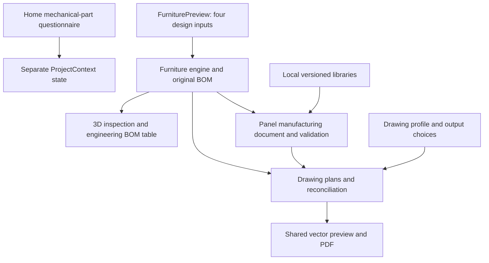

# Product feature inventory — Phase 5UX.1

**Phase 5UX.3 update:** [Hybrid guided manufacturing](hybrid-guided-manufacturing.md) now implements preset-first Basic group decisions, visual questions and reviewed field-specific application. Advanced retains the earlier full editor. Earlier layout/Basic descriptions below are historical where superseded.

**Subsequent implementation:** [Phase 5UX.2](customer-first-workspaces.md) adds Design/Manufacturing workspaces, separate panel/schedule/drawing views, retained drafts and clearer save/replacement actions. Descriptions of the former long page, fallback selection and lost panel drafts below are historical audit findings.

Audit date: **23 November 2026**. This is a repository-based product and architecture audit through Phase 5D.4. It adds documentation only. It does not implement the proposed customer journey, approve manufacturing information or change the interface.

Companion documents: [customer experience blueprint](customer-experience-blueprint.md) and [UX implementation roadmap](ux-implementation-roadmap.md). Those documents describe proposals; this document records the current implementation.

## 1. Product position in plain English

DRAFTELM currently has a working, preliminary **parametric chest-of-drawers application**, with a substantial documentation and manufacturing-data foundation. A manufacturer can change four main design inputs, inspect actual panels, propose panel requirements and download a vector drawing package. It is not yet a complete production planning, purchasing or manufacturing release system.

There are also two separate product experiences. `/` presents an older functional/3D-printable-part questionnaire. `/furniture` opens the chest reference directly. The questionnaire does not generate the chest or populate its engineering specification. This distinction matters when planning a future Describe stage: the existing home-page conversation is not an already integrated furniture assistant.

The reference is a 900 mm wide × 850 mm high × 500 mm deep carcass, with four drawers. Projecting fronts make the closed panel envelope 518 mm deep. It has **29 physical panels**, represented by **seven nominal engineering blank groups**, **87 component measurements** and **26 core functional relationships**, with **20 supporting relationship requests explicitly deferred**. These counts describe this reference, not every drawer count. The engine generates five carcass panels plus six panels per drawer.

## 2. How to read the status labels

| Label | Meaning in this audit |
| --- | --- |
| Working UI | Reachable controls or output exist in the current application. They can still be preliminary. |
| Domain capability | Data/validation logic exists, but there may be no complete user-facing authoring workflow. |
| Demonstration | A real interaction using illustrative assumptions or deliberately synthetic values; no production authority. |
| Placeholder / reserved | A label, button or extension field exists without the implied complete feature. |
| Proposed | A future capability in specifications/roadmaps; not implemented merely because its types are described in a document. |

“Verified” in a supplied data record means the software can check that its evidence reference belongs to that value/revision. It does **not** prove reviewer identity, evidence adequacy, company approval or manufacturing release. All UI-authored manufacturing values remain provisional.

## 3. User-visible inventory

### Entry and older mechanical-part prototype

| Feature | Current behaviour and limit | Evidence / source modules |
| --- | --- | --- |
| Home page and furniture entry | `/` shows a functional-part description box; a navbar link opens `/furniture`. There is no furniture project dashboard or project-type chooser. | [home route](../src/app/page.tsx), [Hero](../src/components/Hero.tsx), [Navbar](../src/components/Navbar.tsx), [furniture route](../src/app/furniture/page.tsx) |
| Describe a functional part | Working questionnaire for recognised mechanical-part words, a specification summary, suggestions and missing-information questions. The logic is local rules/keyword matching, despite `ai` module names and AI-source labels. It is independent of furniture state. | [DesignChat](../src/components/DesignChat.tsx), [EngineeringBlueprint](../src/components/EngineeringBlueprint.tsx), [conversation engine](../src/ai/conversationEngine.ts), [recommendations](../src/ai/recommendationEngine.ts), [validation](../src/ai/validationEngine.ts) |
| Confidence / blueprint complete | Prototype scores and completeness messages exist. They are not engineering confidence measurements or manufacture approval. “Generate 3D design” has no generation handler. | [EngineeringBlueprint](../src/components/EngineeringBlueprint.tsx), [DesignChat](../src/components/DesignChat.tsx) |
| Account, marketing and advertised file types | Sign in has no authentication action; How it works/Examples/Pricing are `#` links. STL/STEP/3MF are advertised in home-page copy, but no corresponding working exporters appear in the inspected application. | [Navbar](../src/components/Navbar.tsx), [Hero](../src/components/Hero.tsx), [app routes](../src/app/) |

### Furniture design and inspection

| Feature | Current behaviour and limit | Evidence / source modules |
| --- | --- | --- |
| Parametric chest | Working UI for carcass width, height, depth and drawer count, regenerated as the input changes. One drawer column and one supported construction family. Invalid combinations withhold preview/BOM; other parts are not silently resized to make a count fit. | [FurniturePreview](../src/components/furniture/FurniturePreview.tsx), [defaults](../src/furniture/defaults.ts), [engine](../src/furniture/engine.ts) |
| Engineering input validation | Reports invalid dimensions, unsupported construction, box/runner fit, panel overlap and required-contact problems. Many construction/thickness/clearance settings exist in the engine specification but are not general UI controls. | [specification validation](../src/furniture/validation.ts), [assembly validation](../src/furniture/assemblyValidation.ts), [types](../src/furniture/types.ts) |
| 3D inspection | Orbit, pan, zoom, fit/reset and panel selection; colours distinguish panel roles. A WebGL failure message keeps non-3D inspection available. It is an inspection model, not a photoreal material/finish preview or a CAD modelling surface. | [FurnitureCanvas](../src/components/furniture/FurnitureCanvas.tsx), [PanelObject](../src/components/furniture/PanelObject.tsx), [viewer adapter](../src/components/furniture/viewerGeometry.ts), [ViewerBoundary](../src/components/furniture/ViewerBoundary.tsx) |
| Layer visibility | Hide/show carcass, drawer boxes, fronts and back. Hiding a layer does not remove parts from the engine or BOM. Selecting a linked part can reveal its layer. | [FurniturePreview](../src/components/furniture/FurniturePreview.tsx) |
| Panel inspector | Select from model or dropdown; see name, original component ID, assembly, world dimensions, minimum-corner position, material and thickness axis. Some drawer selection highlights the parent drawer as context. | [ComponentInspector](../src/components/furniture/ComponentInspector.tsx), [drawer selection](../src/components/furniture/drawerMotion.ts) |
| Drawer opening | Select drawers, open/close individually or set opening percentages, reset movement and edit a demonstration travel limit. Viewer-only movement; no proof of real runner travel, access, load capacity or stability. | [DrawerControls](../src/components/furniture/DrawerControls.tsx), [AnimatedDrawer](../src/components/furniture/AnimatedDrawer.tsx), [motion logic](../src/components/furniture/drawerMotion.ts) |
| Exploded preview | Assembly or individual-panel separation with slider/reset and staged animation. Drawer opening pauses during explosion and returns afterwards. Independent from drawing explosion planning and original manufacturing coordinates. | [ExplosionControls](../src/components/furniture/ExplosionControls.tsx), [preview explosion](../src/components/furniture/explosion.ts), [SceneTransforms](../src/components/furniture/SceneTransforms.tsx) |
| BOM | Panel blank sizes, quantities and linked highlight actions; generic hardware listed separately from rendered panels. This is the original engineering list, not a finished-part registry or an approved purchase order. | [FurnitureBOM](../src/components/furniture/FurnitureBOM.tsx), [BOM generator](../src/furniture/bom.ts) |
| Preliminary status and assumptions | Prominent not-manufacturing-ready warning, validation messages and expandable engineering assumptions. These correctly remain even when the model is geometrically valid. | [FurniturePreview](../src/components/furniture/FurniturePreview.tsx), [defaults](../src/furniture/defaults.ts) |

### Panel manufacturing setup

| Feature | Current behaviour and limit | Evidence / source modules |
| --- | --- | --- |
| Basic / Advanced panel editor | Basic is the initial panel-editor mode, not a whole-application experience. Advanced adds codes, local references, grain sense and selected-edge metadata; some supplied data remains read-only. Switching modes preserves draft fields. | [PanelManufacturingEditor](../src/components/furniture/PanelManufacturingEditor.tsx), [PanelPropertyForm](../src/components/furniture/PanelPropertyForm.tsx) |
| Physical panel selection | All rectangular panel occurrences are editable by stable ID. Selection links to the 3D inspector; without a current selection the editor prefers the first drawer front. A default editor panel can therefore appear while the inspector says no panel is selected. | [PanelManufacturingEditor](../src/components/furniture/PanelManufacturingEditor.tsx), [FurniturePreview](../src/components/furniture/FurniturePreview.tsx) |
| Interactive face/edge diagram | A/B faces, selectable Top/Bottom/Left/Right edges, actual edge lengths, face flip and quarter-turn rotation. Selection stores the physical edge, so screen sides can move without reassigning treatments. The diagram is schematic, not a cutting template. | [PanelFaceDiagram](../src/components/furniture/PanelFaceDiagram.tsx), [panel view mapping](../src/manufacturing/panelView.ts), [topology](../src/manufacturing/topology.ts) |
| Material and grain | Material descriptions/codes refine the existing engineering stock. Grain is explicit along either local face axis, non-directional or unknown; Advanced can constrain its sense. Selecting material does not invent grain or change structural stock/thickness. | [PanelPropertyForm](../src/components/furniture/PanelPropertyForm.tsx), [editing](../src/manufacturing/editing.ts), [catalogue editing](../src/manufacturing/catalogueEditing.ts) |
| Face intent and finishes | Independent A/B decorative/reverse/required-visibility roles, good-face text and finish references or explicit no finish. Required appearance is different from camera visibility. | [PanelPropertyForm](../src/components/furniture/PanelPropertyForm.tsx), [manufacturing types](../src/manufacturing/types.ts) |
| Physical edge treatments | Unknown, explicit no treatment, banding, lipping or other treatment. Generic banding may be incomplete; Advanced exposes material, thickness, appearance and process references. No dimensional deduction is performed. | [PanelPropertyForm](../src/components/furniture/PanelPropertyForm.tsx), [editing](../src/manufacturing/editing.ts) |
| Versioned material/edging/finish libraries | Select a supplied version, review replacement, stage it, then Apply. Create provisional project/company versions from supplied fields; Advanced adds grade, codes, appearance, stock restrictions or process references. Applied panels pin their version. Initially empty; no approved company catalogue service. | [CataloguePresetPicker](../src/components/furniture/CataloguePresetPicker.tsx), [catalogue](../src/manufacturing/catalogue.ts), [catalogue editing](../src/manufacturing/catalogueEditing.ts) |
| Older simple edging presets | Separate local save/load/select workflow remains beside the newer edging library. Same scope/name can replace an older simple preset; this is different from immutable catalogue versions. A migration/consolidation opportunity, not two approval systems. | [PanelPropertyForm](../src/components/furniture/PanelPropertyForm.tsx), [workflow](../src/manufacturing/workflow.ts) |
| Explicit grain matching | Expand a requirement and supply group, face, order, pattern origin and quarter-turn for each occurrence. Notes/schedule identify continuity as UNVERIFIED. No automatic adjacent-front matching, veneer sequencing, nesting or simulated continuous texture. | [PanelPropertyForm](../src/components/furniture/PanelPropertyForm.tsx), [validation](../src/manufacturing/validation.ts), [schedule](../src/manufacturing/schedule.ts) |
| Apply / undo / reset draft | Field edits stay pending until Apply; undo retains up to 40 draft steps; reset restores applied values. These are different from resetting all active properties or saving to browser storage. Pending form state is not a durable project. | [PanelPropertyForm](../src/components/furniture/PanelPropertyForm.tsx) |
| Bulk edits | Explicit checked occurrence list, validated proposal and exact-scope confirmation. Changed draft, scope or document invalidates review. Copies all editable values including unknowns; does not infer groups by equal size. Matching registration must be authored individually. | [PanelPropertyForm](../src/components/furniture/PanelPropertyForm.tsx), [workflow](../src/manufacturing/workflow.ts), [editing](../src/manufacturing/editing.ts) |
| Local property/library persistence | Explicit Save/Load for applied properties and libraries, in separate browser storage keys. Applied references contain snapshots and work before the separate library is loaded. This is not a whole-project file, cloud backup, account or multi-user history. | [PanelManufacturingEditor](../src/components/furniture/PanelManufacturingEditor.tsx), [catalogue](../src/manufacturing/catalogue.ts) |
| Geometry-change review | Retains applied properties but blocks their drawings/PDF when source bindings are stale. Reset or explicit review can carry compatible surviving occurrences as provisional; deleted IDs disappear and incompatible bindings reset. Not automatic reapproval. | [PanelManufacturingEditor](../src/components/furniture/PanelManufacturingEditor.tsx), [rebase logic](../src/manufacturing/editing.ts) |
| Synthetic example | Opt-in sample on one selected panel, prominent example status and labelled exports; exit restores the previous session or defaults. Synthetic library provenance remains labelled when reused. | [PanelManufacturingEditor](../src/components/furniture/PanelManufacturingEditor.tsx), [synthetic adapter](../src/manufacturing/editing.ts), [drawing integration](../src/drawings/manufacturing.ts) |

### Drawings, schedules and downloads

| Feature | Current behaviour and limit | Evidence / source modules |
| --- | --- | --- |
| General assembly | Clean hidden-line-removed parallel isometric, supporting front/top/right views, four nominal envelope dimensions, hierarchical balloons/parts list and placement diagnostics. Not an arbitrary-solid CAD hidden-line system. | [generator](../src/drawings/generate.ts), [GA plan](../src/drawings/planning/gaPlan.ts), [edge visibility](../src/drawings/edgeVisibility.ts), [annotations](../src/drawings/annotations.ts) |
| Exploded/subassembly sheets | Root explosion plus assembled/exploded drawer and carcass drawings, hierarchy-linked lists and geometry-driven fitting. Four root concealment diagnostics intentionally remain for box fronts behind decorative fronts inside rigid drawers; drawer sheets expose the constituents. | [assembly sheets](../src/drawings/assemblySheets.ts), [assembly planner](../src/drawings/planning/assemblies.ts), [explosion planner](../src/drawings/planning/explosion.ts), [composition documentation](professional-drawing-composition.md) |
| Component dimensions | Nominal face dimensions and thickness for all reference panels through grouped CP drawings. The 87 measurements are three per occurrence; this is not a complete machining/inspection dimension set. | [component planner](../src/drawings/planning/componentDimensions.ts), [dimension layout](../src/drawings/componentDimensionLayout.ts) |
| Functional context and sections | Closed front with D/E/F, horizontal C-C with I/J, vertical A-A with B; source-linked gaps, reveals and clearances. All 26 core requests covered; 20 supporting requests deferred. Legacy isolated-edge FD presentation remains an optional diagnostic/compatibility path. | [functional context](../src/drawings/functionalContext.ts), [contextual sections](../src/drawings/contextualSections.ts), [functional planner](../src/drawings/planning/functionalDimensions.ts), [section geometry](../src/drawings/sectionGeometry.ts) |
| Manufacturing panel maps/notes | MP occurrence maps, optional detailed tables and MN continuations. Explicit directional grain arrows, A/B face notes, finishes and E1–E4 physical edge keys/treatment strips. Current displayed face/rotation drives the MP reference view; original CP measurements remain intact. | [manufacturing sheets](../src/drawings/manufacturing.ts), [physical annotation mapping](../src/drawings/manufacturingAnnotations.ts) |
| Shared library legend | Optional LC pages define used pinned versions once; schedules use compact L1/L2 references. No page is created for an empty unused library. Keys are local to the document, not company part numbers. | [catalogue legend](../src/drawings/catalogueLegend.ts), [schedule](../src/manufacturing/schedule.ts) |
| Ten-field manufacturing schedule | Part number; description; quantity; L × W × T; material/code; grain; edge treatments; finished dimensions; surface finish; manufacturing notes. Unassigned fields say Not specified. Part numbers and finished sizes are not calculated. | [live table](../src/components/furniture/ManufacturingSchedule.tsx), [schedule data](../src/manufacturing/schedule.ts) |
| Schedule grouping/traceability | Expand compatible verified-property variants to inspect their occurrences; provisional/unknown variants remain separate, so the reference has 29 rows. Printed MS retains occurrence rows. Traceability links back to physical panels and original BOM. | [ManufacturingSchedule](../src/components/furniture/ManufacturingSchedule.tsx), [variants](../src/manufacturing/variants.ts) |
| Workshop / Engineering profiles | Both work with first-/third-angle projection and A4–A1 landscape. Currently they largely share content defaults; Engineering changes presentation/name, not engineering meaning or approval. Profile and template are separate exposed controls. | [profiles](../src/drawings/profiles.ts), [DrawingSettings](../src/components/drawings/DrawingSettings.tsx) |
| Configurable package and company fields | Sheet/view/balloon controls, property-output scope, compact/detailed notes, schedules, library legend, title-block fields, revision labels and numbering. Versioned preference migration and local Save/Load/Reset. Semantic lineweight overrides exist in the profile API; no full template/style editor. | [DrawingSettings](../src/components/drawings/DrawingSettings.tsx), [preferences](../src/drawings/preferences.ts), [style](../src/drawings/style.ts) |
| Vector preview/PDF | Select a sheet and download the entire currently configured package. Shared vector primitives preserve source-linked lines/text in browser/PDF; print at Actual size. No UI for individual-file downloads, CSV/XLSX/ZIP, DXF/DWG or machining exports. | [DrawingPanel](../src/components/drawings/DrawingPanel.tsx), [SheetPreview](../src/components/drawings/SheetPreview.tsx), [plot](../src/drawings/plot.ts), [PDF](../src/drawings/pdf.ts) |
| Export protection | Revalidates captured drawings/properties; rejects stale/tampered bindings and cancels download if live drawing inputs change during export. Unsupported manufacturing text characters withhold PDF instead of substituting codes. Full Unicode PDF fonts are incomplete. | [DrawingPanel](../src/components/drawings/DrawingPanel.tsx), [GA validation](../src/drawings/planning/gaValidation.ts), [manufacturing validation/render boundary](../src/drawings/manufacturing.ts), [PDF](../src/drawings/pdf.ts) |
| Coverage and presentation diagnostics | Reconciliation, measurement coverage, omitted content, unplaced balloons, visibility and sheet utilisation reports are visible near the preview. Valuable evidence, currently mixed into the main customer task. | [DrawingPanel](../src/components/drawings/DrawingPanel.tsx), [reconciliation](../src/drawings/reconcile.ts), [composition](../src/drawings/composition.ts) |

## 4. Engineering systems behind the screen

| System | Explanation for the product owner | Responsibility boundary |
| --- | --- | --- |
| Furniture specification and generator | A structured recipe produces every panel location, size, assembly and hardware allowance consistently. | [furniture](../src/furniture/): source of nominal geometry and original BOM. Navigation must not duplicate its calculations. |
| Physical identities and local frames | Each actual panel has a permanent name; its two broad faces and four edge surfaces have their own references. A local frame follows the panel rather than the camera. | [topology](../src/manufacturing/topology.ts), [panelView](../src/manufacturing/panelView.ts). Top/right screen labels are translations, not saved physical identities. |
| Source bindings and revisions | Records capture exactly which model and panel orientation they describe. Changing a model can make a previously sensible instruction stale. | [engineering revision](../src/furniture/revision.ts), [manufacturing source](../src/manufacturing/source.ts), [validation](../src/manufacturing/validation.ts). Comparison fingerprints are not signatures. |
| Manufacturing properties | A separate document describes what material, grain, face quality, treatment and finish is required, including unknowns. | [types](../src/manufacturing/types.ts), [properties](../src/manufacturing/properties.ts). It supplements geometry; it does not resize panels. |
| Occurrence / variant / blank grouping | An occurrence is one actual panel. A manufacturing variant describes matching finished requirements. A blank group describes compatible raw stock sizes/restrictions. These are different ways of organising the same panels. | [variants](../src/manufacturing/variants.ts). Equal sizes do not prove equal finished requirements; unknowns do not approve grouping. |
| Semantic drawing plans | The software records what a dimension/view means and which source parts it refers to before deciding where to draw it. A reference repeat is the same measurement in another view. | [planning modules](../src/drawings/planning/). Their meaning survives different paper layouts. |
| Presentation and vector rendering | Fit drawings, dimensions, balloons and tables into real paper space, then use common drawing instructions for screen and PDF. | [layout](../src/drawings/layout.ts), [composition](../src/drawings/composition.ts), [plot](../src/drawings/plot.ts), [style](../src/drawings/style.ts). Formatting cannot invent an engineering value. |
| Validation and reconciliation | Check that no parts or quantities disappeared, references still resolve, and output still matches captured inputs. | Engine, manufacturing and drawing validators all contribute. A successful check is scoped consistency evidence, not a release certificate. |

### Current data ownership and persistence

There is no arrow from the home questionnaire to the furniture specification. The root [ProjectContext](../src/state/ProjectContext.tsx) serves the older prototype, not a furniture project store.

| Current owner | What it holds | Survives a page reload? |
| --- | --- | --- |
| `FurniturePreview` | Four design inputs, selection, layers, movement/explosion/view state. | No complete furniture specification save/load exists. |
| `PanelManufacturingEditor` | Applied property session, library, synthetic restore state, mode, per-panel displayed face/turn. | Applied properties and catalogue only through separate explicit local saves/loads; no full session restoration. |
| Keyed `PanelPropertyForm` | Pending fields, draft undo, current edge, bulk proposal/confirmation, legacy presets. | Unapplied text is not saved. Changing panel replaces the form; pending edits need protection in a future UX. |
| `DrawingPanel` | Profile, selected sheet and export state. | Profile through explicit preferences Save/Load; no whole-project export baseline/history store. |

Four separate local workflows exist: panel properties, versioned library, legacy edging presets and drawing preferences. “Save panel properties” saves applied data, not pending form text or the furniture geometry. A saved document can consequently require the matching geometry to be reconstructed and reviewed before use. “Project/company” library scopes are local labels, not authenticated workspaces.

## 5. Output length: current facts

The latest implementation documentation records **16 A3 pages** for new application defaults: the earlier 12-page drawing package, plus one selected-panel MP map, with the one-page nominal CL table replaced by four occurrence-level MS pages (**12 + 1 − 1 + 4 = 16**). The reviewed synthetic library example adds one LC page, giving **17**. Long notes, changed scope/format, saved settings or continuations can change these counts.

Legacy API calls without manufacturing input still have a 12-page reference package. Older regression fixtures also deliberately retain earlier six-/nine-/seventeen-page outputs. Those tests are compatibility cases, not evidence that every user currently gets that count. CP drawings contain nominal blank measurements; MP maps add occurrence-specific properties. They overlap in geometry but do not have the same responsibility.

Workshop/Engineering currently inherit essentially the same sheet content. Neither is yet the concise Workshop versus detailed Engineering product preset proposed in the blueprint. Output is also linked to the current panel selection, which can alter the package without an explicit export-scope step.

## 6. Incomplete capabilities and future ideas

| Area | Implemented portion | Still absent / must not be sold as completed |
| --- | --- | --- |
| Furniture families and Describe | Chest recipe and older independent questionnaire. | Natural-language furniture generation, arbitrary furniture types, multiple columns and a project dashboard. |
| Precise engineering controls | Source schema supports construction/stock/runner settings with validation. | A comprehensive Advanced UI, arbitrary solids, free modelling or controlled geometric override editor. |
| Company manufacturing setup | Local typed definitions, owner labels, versions and evidence consistency checks. | Company accounts, roles, shared approved catalogue, authenticated policy, revocation/history and supplier integration. |
| Finished manufacturing | Nominal panels and source-bound proposed requirements. | Approved finished-to-blank rules, edging deductions, nesting, machining/drilling geometry, tolerances, inspection plans or structural/stability substantiation. |
| Matching and materials | Explicit pattern direction/group registration and finish references. | Continuous-grain feasibility, sheet/veneer sequencing, stock yield and realistic rendered textures. |
| Part identity | Stable occurrences, BOM references and comparison fingerprints. | Durable company part numbers/SKUs and an assessed interchangeability policy. |
| Drawing company templates | Native profiles, title fields, bounded lineweight overrides; reserved extension IDs. | Imported DWG/DXF templates, arbitrary logo/border editors or drag-and-drop CAD drawing editing. |
| Deliverables | Whole configured vector PDF. | Standalone schedule downloads, CSV/XLSX/ZIP, manifests, individual drawing downloads, STEP/STL/3MF/DXF/DWG or CNC output. |
| Approval and release | Preliminary flags, warnings, evidence binding and stale rejection. | An authorised release workflow. `manufacturingReady=false` and `complianceVerified=false` remain mandatory; unverified hardware has zero approved purchasing quantity. |

The [drawing/manufacturing specification](drawing-manufacturing-specification.md) is a requirements document, and much of the [architecture roadmap](drawing-architecture-roadmap.md) is historical proposal text with later implementation updates appended. Future-looking interfaces there must not be mistaken for executable features. Latest milestone documents and current source determine this inventory.

## 7. Evidence, tests and audit limits

The latest recorded verification is **786 passing tests**, TypeScript/lint, Webpack production build and Chrome/vector A3 PDF checks on **19 November 2026**, documented in [Phase 5D.4](manufacturing-libraries-drawing-integration.md). This audit inspected sources and relevant test cases; it did **not** rerun them, generate a new PDF or perform new browser/usability testing.

| Inspected test sources | What they protect |
| --- | --- |
| [furniture](../tests/furniture.test.ts), [viewer geometry](../tests/viewerGeometry.test.ts), [drawer motion](../tests/drawerMotion.test.ts), [explosion](../tests/explosion.test.ts) | Source geometry/BOM, parameter changes and independent presentation transforms. |
| [assembly drawings](../tests/assemblyDrawings.test.ts), [component dimensions](../tests/componentDimensions.test.ts), [functional context](../tests/functionalContext.test.ts), [composition](../tests/drawingComposition.test.ts) | Hierarchy, 87/26 reference coverage, sections/details, fitting and paper presentation. |
| [manufacturing foundation](../tests/panelManufacturing.test.ts), [visible properties](../tests/visibleManufacturing.test.ts), [workflow](../tests/manufacturingWorkflow.test.ts), [libraries](../tests/manufacturingLibraries.test.ts) | Physical mappings, unknown/provisional distinctions, variant/blank partitions, bulk review, catalogue pins and stale export data. |
| [drawing profiles](../tests/drawingProfiles.test.ts), [drawing package](../tests/drawingPackage.test.ts) | Migration/settings, hidden-data reconciliation, numbering, preliminary flags and vector output. |

The [test runner](../tests/run-tests.mjs) compiles and runs TypeScript test modules. The repository does not contain a checked-in Playwright/Cypress browser suite; previous Chrome scripts/artifacts are recorded in milestone documentation, including temporary paths. Strong engineering regressions do not establish that first-time customers understand the workflow. The UX findings below are source-based expert assessments to validate with manufacturers, not measured user-study results.
