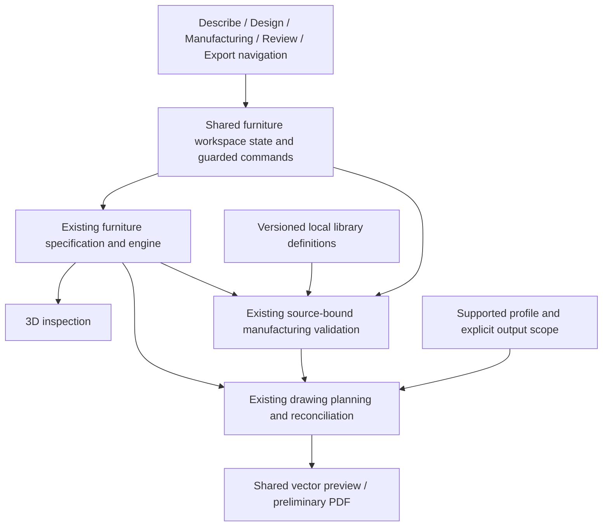

# UX implementation roadmap — Phase 5UX.1

**Implementation update:** [Phase 5UX.2 workspaces](customer-first-workspaces.md) now implement the first Design/Manufacturing separation and editing protections. Subsequent milestones remain proposed. Historical audit delivery/test statements below refer to documentation-only 5UX.1, not the later source changes.

Audit date: **23 November 2026**. The original 5UX.1 delivery was documentation and architecture analysis only, with no source changes or test/build run. The subsequent 5UX.2 implementation is recorded above; the remaining milestones below are proposals.

Read the [feature inventory](product-feature-inventory.md) for current capabilities and the [customer experience blueprint](customer-experience-blueprint.md) for the proposed five-stage journey. This roadmap supplements the [engineering architecture roadmap](drawing-architecture-roadmap.md); it does not replace engineering validation or authorise its future release capabilities.

## 1. What to do first

Implement **5UX.2: a state-preserving Design / Manufacturing workspace split**. The first screen should show the cabinet, its four design inputs, a clear preliminary status and optional inspection tools. Open manufacturing editing deliberately. Keep existing drawings, schedule and their configuration available within the manufacturing workspace during this first increment.

This is deliberately smaller than implementing Describe, Review, Export, a project database and a new Basic editor together. It gives a visible reduction in simultaneous controls while testing the most important architectural risk: moving between tasks must not create a second model or lose work.

Do not begin with new furniture features, a generic CAD editor, new AI integration, template import or a framework/store rewrite. The present pure engine, manufacturing validators and vector drawing pipeline are reusable. The work is primarily how customers enter, select, edit, understand and review those systems.

## 2. Architectural rules for every UX milestone

### One project, separate kinds of state

| State category | Proposed responsibility | Must not happen |
| --- | --- | --- |
| Engineering input | One authoritative furniture specification and current validation result, derived through the existing engine. Preserve invalid pending input and explain why it cannot produce output. | Each stage builds its own specification/BOM, or an old valid model appears to represent newly invalid input. |
| Manufacturing data | One source-bound applied property document with pinned catalogue snapshots and synthetic provenance. Existing validation/rebase rules remain authoritative. | A simplified screen rewrites unknowns to none, infers a good face or makes a catalogue selection into occurrence approval. |
| Pending edits | Explicit draft ownership keyed to the physical occurrence and its source binding; warn/resolve before a transition would discard it. | Tab remounts reset values, or a draft for an old revision is applied without review. |
| Selection and presentation | Shared active occurrence/assembly context; separate explicit edit scope, displayed face/turn, camera and export scope. | Selecting a highlighted drawer edits all its parts; selecting an MP changes a confirmed export scope silently. |
| Output preferences | One current profile and supported company presentation settings, with migrations and separate navigation state. | Basic/Advanced changes geometry or silently resets saved profile inclusion choices. |
| Derived documents and rows | Continue to derive schedules, variants and drawings from the same current source/properties/profile, retaining captured-input validation. | New screens or exports calculate sizes, quantities, group equivalence or material requirements independently. |
| Status and authority | Translate existing errors/warnings/coverage into human-readable tasks. Keep unsupported approval capability explicit. | Navigation completion, custom metadata or a local review checkbox grants manufacturing readiness. |

### Proposed dependency direction

This is a proposed ownership diagram, not a new module implementation. The manufacturing domain continues to depend on the furniture domain, not React or the drawing renderer. The drawing system consumes manufacturing data; it does not author engineering specifications. Changing task navigation is not itself a source revision, while changing captured drawing inputs still invalidates old output.

The existing `src/state/ProjectContext.tsx` belongs to the separate mechanical-part prototype. Do not move furniture into it without an explicit new contract. A small furniture-specific parent state owner or provider is sufficient; no external state library is justified by this audit. Choose implementation details when the first milestone is scoped, and move only the state whose lifetime needs to outlast a screen.

### Data and wording invariants

- Preserve the original engineering coordinate system, occurrence IDs, geometry and BOM formulas. The reference stays 29 panels, 87 component measurements and 26 core functional relationships, with the 20 supporting deferrals accounted for.
- Preserve unknown, explicit none, provisional and supplied verification as distinct states. A compact summary must not erase their exact underlying values.
- Preserve all ten schedule fields, source BOM membership and conservative variant/stock grouping. Show part names in Basic; keep IDs/refs inspectable.
- Keep `manufacturingReady=false`, `complianceVerified=false` and unverified hardware excluded from approved purchasing. No UX milestone introduces release authority.
- Keep stale source/property/profile checks, vector browser/PDF parity, both profiles, both projection conventions, local migrations and synthetic provenance/restore.
- Distinguish **Apply to project**, **Save locally**, **Discard pending edits** and **Reset scope**. Do not silently commit a draft because the customer navigated away.

## 3. Recommended milestones and exit criteria

### 5UX.2 — Design workspace and safe task switching

**Visible outcome:** a new visitor sees the cabinet and four main design inputs, with a deliberate route to manufacturing; large panel/drawing forms are not presented on the initial design screen. This is an interim two-workspace arrangement, not the finished five-stage navigation.

Scope:

- Introduce Design and Manufacturing task areas under one furniture workspace. Preserve existing drawing/schedule capabilities inside Manufacturing for now; do not add empty Describe/Review/Export stages.
- Place layers, movement, explosion and detailed inspection under contextual viewer tools, keeping their demonstration status. Keep geometry errors and preliminary manufacturing status visible.
- Establish a shared, named active physical panel; remove the disagreement between the inspector's empty selection and the editor's fallback selection. Do not equate inspection highlighting with bulk scope.
- Preserve component state across task changes or move necessary ownership upward. Use a guard if panel selection, load/reset or task navigation would destroy a dirty form: Apply and continue, Discard and continue, or Stay.
- Keep current field coverage, local persistence, profile settings, schedule and drawing generator unchanged. No new export preset or catalogue migration in this slice.

Acceptance:

| Scenario | Required observation |
| --- | --- |
| Open the reference | Four design inputs are immediately available; panel/library/drawing configuration is absent from the Design workspace. Preliminary status and a clear Manufacturing action remain visible. |
| Switch tasks repeatedly | Cabinet inputs, selected panel, face/turn, applied properties, profile and pending draft remain intact; the viewer returns at a usable size. |
| Change panel with a dirty draft | Apply/Discard/Stay are explicit. Failed validation retains the draft and selection. No silent discard. |
| Select from 3D, part list or schedule | Same physical occurrence/name is active in inspector/editor/drawing; contextual drawer highlighting does not enlarge edit scope. |
| Change geometry after applying properties | Existing stale-data withholding and explicit provisional rebase still work, even if the editor is not currently visible. |
| Use PDF and local save/load | Existing outputs and source snapshots remain semantically equivalent for the same inputs. No applied/pending distinction is lost. |
| Keyboard / narrow screen / unavailable WebGL | Tasks and part selection are accessible; active controls are labelled; hidden workspaces do not receive focus; form/table access does not depend on 3D. |

Likely source seams: [FurniturePreview](../src/components/furniture/FurniturePreview.tsx), [PanelManufacturingEditor](../src/components/furniture/PanelManufacturingEditor.tsx), [PanelPropertyForm](../src/components/furniture/PanelPropertyForm.tsx), [ComponentInspector](../src/components/furniture/ComponentInspector.tsx) and narrowly scoped drawing-selection plumbing. Extract composition seams as needed; do not replace these systems wholesale.

**Go/no-go:** demonstrate that a manufacturer can change cabinet size, enter Manufacturing, edit one named panel and return without losing values or searching through the full drawing configuration. Fix state loss before adding more navigation.

### 5UX.3 — Contextual Basic manufacturing and library consolidation

**Visible outcome:** a selected panel shows four short tasks—Material, Face/finish, Grain and Edges—rather than all authoring controls at once. Clicking an edge opens that edge's concise choice.

Scope:

- Use one primary Apply action, a clear pending/applied status and visual before/after confirmation. Keep full current editable fields reachable in Advanced.
- Move definition creation/version administration out of the ordinary picker into Libraries. Keep a contextual provisional custom-value route, plus exact version/status visibility.
- Consolidate the old edging presets with versioned library selection through an explicit reviewed migration. Preserve original saved data and treatment states; legacy replacement semantics must not silently become a claimed approved version.
- Add field-scoped reuse only through a validated operation: “apply this material” must not copy unknown finishes/edges. Named part-set selection can propose scope, never confirm it automatically.
- Put explicit matching registration behind a contextual request/specialist section, not an everyday setup requirement.

Acceptance: Basic/Advanced round-trip preserves the full draft; A/B flips and quarter-turns preserve edge identities; Unknown/No treatment/Specified stay distinct; material-only bulk updates preserve all unrelated properties and matching registrations; review invalidates after any relevant change; old presets restore/migrate without loss; equal-sized provisional panels remain distinct variants. Test a differently oriented target before permitting any convenience edge-copy action.

Dependency: 5UX.2 draft/selection lifetimes. Approved company preset selection remains conditional on a later real authority source; local proposals must keep their current status.

### 5UX.4 — Project entry and honest local project recovery

**Visible outcome:** a supported Describe entry starts the chest reference, and the customer can understand what has been saved and restore a complete local project when that capability is added.

Scope:

- Introduce Describe with supported reference/type, optional project name and a brief. Do not connect keyword guesses to engineering values without explicit confirmation and validation.
- Align furniture entry copy with actual capabilities; distinguish the older mechanical-part prototype and unavailable account/export actions.
- Design a versioned local project envelope for engineering inputs, applied properties/pins, synthetic state and profile; decide separately whether/how pending drafts and display preferences persist. Restoration must reconstruct source geometry before validating properties.
- Import existing separate local records explicitly and report missing matching source inputs. Never claim an old properties-only save can reconstruct the cabinet specification.

Acceptance: reference/modified-size round-trips restore the same source and IDs; corrupt/future versions and incompatible stock are rejected safely; property-only legacy saves retain a review path; synthetic state survives and exits honestly; storage failures are visible; navigation does not appear as a new engineering change. No account, cloud sync or automatic approval claim.

Dependency: stable workspace ownership. This is separate from the first navigation slice because persistence/migration deserves its own contract and recovery tests.

### 5UX.5 — Review workspace and actionable requirements

**Visible outcome:** Review combines a navigable drawing preview with a short, grouped list of actual outstanding decisions and source/presentation issues. It does not require reading raw JSON to understand a bulk proposal or an unresolved finish.

Scope: adapt existing diagnostic codes to named parts/tasks; distinguish invalid geometry, stale bindings, unresolved/provisional specifications, hidden/unplaced displays, deliberate supporting deferrals and composition issues. Link each to the correct source/editor/view. Keep exact references available. Put engineering BOM and full coverage behind appropriate disclosure. Show release capability as unavailable with reasons.

Acceptance: every underlying diagnostic remains reachable after grouping; counts use a stated scope; selecting a diagnostic opens the correct physical occurrence/view; no green “ready” status appears merely because rendering succeeds; unverified loads/fixings/stability remain evident even when panel fields are filled. A company-approval UI is not part of this milestone.

Dependency: shared IDs/selection and the documented status vocabulary. A task list is a presentation adapter, not a new engineering requirements engine.

### 5UX.6 — Purpose-based Export workspace

**Visible outcome:** customers choose concise Workshop or detailed Engineering preliminary output, inspect actual included/omitted sheets and page count, then download the same captured vector package they reviewed.

Scope: implement and test the [output matrix](customer-experience-blueprint.md#7-drawing-output-proposal); separate export scope from incidental current selection; provide company/setup disclosure; retain detailed per-sheet controls and existing profiles/migrations. Start with whole configured PDF. Individual files, standalone schedules and CSV/XLSX/ZIP remain separate engineering work.

Acceptance: all applicable reference component/functional measurements remain accounted for under each preset; omissions are explained; referenced library keys have accessible definitions; hiding a sheet cannot remove its internal requirements; actual page count follows generation, not a fixed marketing target. Test both profiles/projections, A4 continuations and long notes. Compare SVG/PDF vectors and visually review representative A3 pages. Changing captured inputs during export must still cancel stale download.

The blueprint's roughly 12-page concise reference set is an estimate to verify, not an acceptance requirement. A readable, correctly scoped 13-page result is preferable to dropping information to achieve a number. Preserve the current 16/17-page baseline until explicit new defaults are implemented and reviewed.

### 5UX.7 — Manufacturer usability validation and refinement

**Visible outcome:** terminology and defaults reflect observed workshop tasks rather than assumptions from internal development.

Use a small formative study with about five representative manufacturers, including users unfamiliar with the application. This is a proposed study, not evidence already gathered. Ask them to size the chest, find a named front, assign a provisional grain/face/edge requirement, review a bulk material proposal, recover after a width change and select a preliminary PDF. Include a keyboard/narrow-screen session and a participant without supplied company definitions.

Proposed acceptance targets: at least four of five complete each ordinary task without facilitator navigation; every participant can identify that output is preliminary; no unnoticed wrong-panel/wrong-edge bulk update or lost edit; users can explain Apply versus Save and identify an unresolved requirement. Record completion, help requests, wrong selections and confidence in what will be exported. Compare against the current workflow; do not turn these provisional targets into claimed improvements without observations.

Study the first 5UX.2 slice early; do not wait for every later milestone before checking whether task separation helps. Later refinements should respond to observed difficulty and regression risk.

## 4. Verification strategy for future source changes

No tests/build were rerun for this documentation-only audit. The latest recorded result is **786 tests** plus TypeScript, lint, Webpack build and Chrome/PDF checks in [Phase 5D.4](manufacturing-libraries-drawing-integration.md). That is historical evidence, not a fresh 5UX.1 result.

For each implemented milestone, run the existing relevant automated suite, TypeScript, lint and Webpack production build. Add focused interaction checks for navigation/drafts/selection/bulk scope; domain-only tests do not establish React state lifetime. Make the browser checks repeatable in the repository when implementing these workflows, rather than relying solely on temporary external scripts. Use synthetic fixtures for supplied definitions/verification, never unapproved production defaults.

| Regression family | Future checks |
| --- | --- |
| Reference conservation | 29 occurrence IDs, seven original nominal blanks, 87 component measurements, 26 core relationships and explicit 20 deferrals; identical original BOM for identical engineering input. |
| Parameter range | Widths 900/1000/1100/1200 mm and existing valid height/depth/count fixtures; invalid count/height combinations stay invalid. Different drawer counts conserve their own `5 + 6 × count` panels, not a fixed 29. |
| Manufacturing meaning | Physical face/edge mapping under flips/turns; opposite finishes; grain versus stock direction; matching explicitness; unknown/provisional isolation; blank versus finished-variant distinction. |
| Commands and drafts | Apply/Discard/Stay, mode switches, source changes with a dirty form, load/reset, exact field-scoped bulk review and cancellation when inputs change. |
| Recovery | Existing storage/profile migrations, properties-only legacy data, pinned versions, conflicting versions, stale source reconstruction and synthetic restoration. |
| Output | Both profiles and projection conventions; visible/hidden sheets, actual page counts, full traceability, printed text/lineweights, vector parity and stale export cancellation. |
| Experience | Named selection without raw IDs, actionable errors, keyboard focus, no WebGL fallback and narrow-screen access; actual manufacturer task sessions. |

## 5. Risks and controls

| Risk | Control / decision |
| --- | --- |
| Moving screens loses state | Explicit lifetime ownership, dirty-draft guard and browser transition tests before broader redesign. |
| Basic conceals unresolved manufacturing work | Persistent preliminary status plus complete Review issue scope. Simplify presentation, never substitute values or suppress validation. |
| Simpler bulk action erases unrelated data | Introduce a tested field mask/patch command; keep exact IDs/orientation review and atomic validation. Never reuse the all-fields copy invisibly. |
| New UI calculates engineering data twice | Existing engine/domain resolvers remain the only calculation sources; screen adapters translate names/statuses. |
| “Company” or Advanced implies authority | Keep local proposal status, separate edit permission from approval authority and offer no approval bypass. Real authorised overrides need a separate identity/evidence/policy design. |
| Shorter PDF hides engineering scope | Explicit subset policy, omitted-content report, complete semantic traceability and coverage tests. No font shrinkage or provisional equivalence to achieve a page target. |
| New defaults overwrite existing company settings | Versioned opt-in migration/reset and saved-profile fixtures; retain supported metadata, templates and both projections. |
| Local save is mistaken for a backup | Explicit browser-only status; whole-project recovery schema and failure handling before a unified Save promise. |
| Home-page promises outrun product | Separate working furniture entry, prototype and unavailable exports/accounts; test customer expectations. |

## 6. Product-owner decisions

These are decisions for implementation planning, with recommendations; no answers are required to complete this audit.

| Decision | Recommendation and consequence |
| --- | --- |
| Initial supported product | Lead with the single-column chest reference. Show broader furniture generation as future scope rather than a non-working picker. |
| First investment | Approve the narrow 5UX.2 workspace/draft/selection slice before more manufacturing features. Review it with workshop users. |
| Basic defaults without company data | Offer local provisional proposals or explicit unknowns. Do not invent a “standard workshop” material/treatment bundle. |
| Default learning path | Learn through the real unspecified reference; keep synthetic demonstration opt-in and reversible. |
| Editing granularity | Prefer named field-scoped proposals and explicit occurrence sets; retain precise physical identities and Advanced inspection. |
| Drawing purpose | Agree the concise preliminary subset and the detailed package separately. Preserve the 26 core contextual relationships unless a separately reviewed scope policy explicitly says otherwise. |
| Save promise | Current browser saves are partial. Deliver a tested local whole-project envelope before advertising complete project recovery; company accounts remain a separate programme. |
| Approval / custom overrides | Custom supported values are provisional. Authorised approvals/overrides require controlled identity, evidence and release policy beyond this UX roadmap. |

## 7. Audit delivery record

Created only [product-feature-inventory.md](product-feature-inventory.md), [customer-experience-blueprint.md](customer-experience-blueprint.md) and this file. Findings come from current app routes/components, state ownership, furniture/manufacturing/drawing modules, relevant tests and milestone/specification documents. Usability observations are reasoned hypotheses, not a new customer study; page-count targets are marked estimates. No source files, models, BOM formulas or tests were modified. No commits or pushes were performed.
